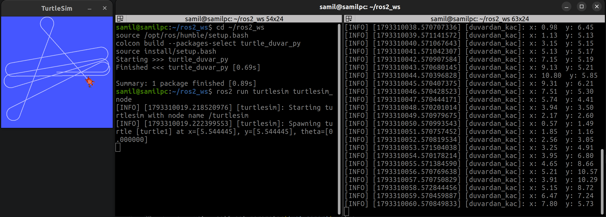

# Duvardan Kaçan Kaplumbağa

# Çalıştırma Adımları

```bash
git clone <REPO_URL> ~/ros2_ws/src
cd ~/ros2_ws
colcon build
source install/setup.bash
ros2 run turtlesim turtlesim_node
```

'Başka terminalde'
```bash
cd ~/ros2_ws
source install/setup.bash
ros2 run turtle_duvar_py duvardan_kac
```

# Ekran görüntüsü
